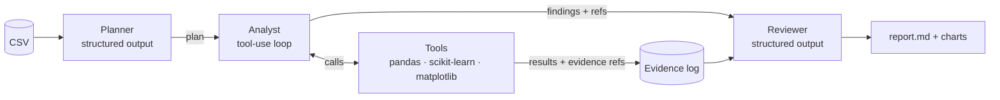

# agentic-data-analyst

[](https://github.com/harshithkonatham/agentic-data-analyst/actions/workflows/ci.yml)

A small team of **Claude agents** that analyses any CSV the way a data team would:
a **Planner** decides what to look at, an **Analyst** runs the analysis with real tools,
and a **Reviewer** checks every claim against the numbers before it reaches the report.

Built on the **Anthropic Python SDK** (tool runner + structured outputs) with
`claude-opus-5-5`. Draws on my MSc modules in *Applied Data Analytics* and
*Machine Learning Foundations*.

## Why it's built this way

LLM "data analysts" are easy to demo and hard to trust: they make up numbers. This project
is designed so they can't:

- **Every number comes from a tool, not the model.** Pandas and scikit-learn do the
  analysis; Claude only decides *which* analysis to run and how to explain it.
- **Every finding must cite evidence.** Each tool call gets a ref like `correlations#3`.
  `record_finding` rejects a finding that cites a ref that doesn't exist.
- **A second agent reviews the first.** The Reviewer sees each claim *next to the tool
  output it cites* and marks it ✅ supported, ⚠️ weak (e.g. causal wording for a
  correlation) or ❌ unsupported. The summary uses only supported findings.
- **Runs without an API key.** `--offline` runs a fixed recipe through the same tools, so
  tests and CI are free and deterministic, and you have a baseline to compare the agents with.

## How it works



| Agent | How it's built | Output |
|---|---|---|
| Planner | `client.beta.messages.parse` with a Pydantic schema | `AnalysisPlan` (goal + steps) |
| Analyst | `client.beta.messages.tool_runner` with 8 `@beta_tool` functions | Findings with evidence refs |
| Reviewer | `client.beta.messages.parse` with a Pydantic schema | Verdict per finding, summary, caveats |

Tools: `describe_column`, `missing_values`, `correlations`, `group_summary`,
`train_baseline_model` (cross-validated random forest + feature importances),
`plot_histogram`, `plot_scatter`, `record_finding`.

Production touches: adaptive thinking with a configurable `effort`, server-side refusal
fallback (`fallbacks="default"`), a cap on agent iterations, and tool errors returned
to Claude to fix (e.g. a misspelt column name) instead of crashing the run.

## Quick start

```bash
uv sync

# No API key needed: rule-based run on the bundled wine dataset
uv run analyst demo --offline

# With Claude
export ANTHROPIC_API_KEY=sk-ant-...
uv run analyst demo
uv run analyst analyze path/to/data.csv --target churn \
    --question "Which customers are most likely to churn, and why?"
```

The report is written to `reports/report.md`, with charts in `reports/charts/`.

Options: `--offline`, `--model` (default `claude-opus-5-5`), `--effort low|medium|high|xhigh`,
`--out DIR`.

## Example (offline run on the wine dataset)

> A RandomForestClassifier predicts `cultivar` with **f1_macro = 0.97 ± 0.02** over
> 5-fold cross-validation. The model relies most on `proline`, `flavanoids` and
> `color_intensity`.

Each finding in the report shows its reviewer verdict and evidence refs, and an appendix
lists every tool call with its arguments and results.

## Development

```bash
uv run pytest --cov      # 20 tests, ~97% coverage; the agents are tested with a fake client
uv run ruff check . && uv run ruff format --check .
uv run bandit -q -r src -ll
```

CI (GitHub Actions) runs lint, tests with an 85% coverage gate, Bandit, pip-audit and
Gitleaks, then the offline demo, and uploads its report as a build artifact.

## Project layout

```
src/agentic_analyst/
  agent.py      Planner, Analyst and Reviewer (Anthropic SDK)
  tools.py      Deterministic analysis tools + evidence logging
  offline.py    Rule-based pipeline (no API key)
  report.py     Markdown report
  workspace.py  Dataset, evidence log and findings for one run
  cli.py        `analyst` command
```

## Ideas for next steps

- Run the Reviewer on a cheaper model (e.g. Claude Haiku) and compare verdicts
- An eval set of datasets with known answers, to score agent runs against the offline baseline
- Serve it as an MCP server so other agents can request an analysis
